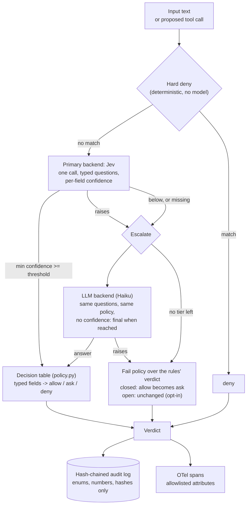

# Architecture

Everything runs offline against synthetic data. The model backends (Jev, Claude Haiku) are built and offline-tested, and were **never run**; the evals use the deterministic rules backend and a keyword stub.

## One decision

## Two gates, two sets of typed questions

| Gate | Asked | Typed answers | Table (rule: condition -> decision) |
|---|---|---|---|
| `InputGate.check(text, task_context)` | does the text try to instruct an assistant, with what intent, and how much harm if obeyed | `addresses_assistant: bool`, `intent: none / instruction / exfiltration / impersonation / authority_pressure / other`, `risk: 0..3` | I1 addresses and risk >= 2 -> deny; I2 addresses (risk 0-1) -> ask; I3 not addressed, risk 1 -> ask; I4 not addressed, risk >= 2 -> ask; I5 otherwise -> allow |
| `ActionGate.check(task, tool, args, context)` | is this call consistent with the task, does it touch sensitive data | `consistent_with_task: bool`, `touches_sensitive_data: bool` | A1 not consistent -> deny; A2 consistent and sensitive -> ask; A3 -> allow |

`intent` is carried for audit and analysis; the table does not use it. The `ask` outcome also arises from escalation and from fail-closed.

## Layers

| Layer | File | Responsibility |
|---|---|---|
| Types | `src/peephole/types.py` | Pydantic v2: the questions models (also the Pydantic AI `output_type`, so one call answers all fields) and the verdicts |
| Policy | `policy.py` | The single threshold (0.8), hard-deny score, fail policy, both decision tables, and the policy text the model backends receive |
| Backends | `backends/` | One Protocol: `RulesBackend` (deterministic; Whetstone rules copied, plus an action allow-list), `JevBackend`, `LLMBackend` (lazy SDK imports), `MockBackend` (test double), `ChaosBackend` (failure injection) |
| Cascade | `cascade.py` | Hard deny, ordered tiers, threshold, fail policy, tracing of each backend call |
| Gates | `gates.py` | `InputGate`, `ActionGate`: a cascade plus an audit record and a span per decision |
| Audit and traces | `audit.py`, `tracing.py` | Hash chain; content-free spans (attribute allowlist, safe-string pattern) |
| Evaluation | `evaluation.py`, `stats.py`, `datasets/` | Run, summarise, calibrate; Wilson, ECE, risk-coverage and percentile in the standard library |
| Live runner | `live.py`, `scripts/run_live_eval.py` | Guarded, resumable, budgeted; stub-tested only |
| Evals | `evals/` | One command, offline: rules and stub only |

## Confidence handling

`Answer.confidence` is the minimum over the per-field confidences, or `None` when nothing exists. `extract_confidences` reads `result.response.provider_details['confidence']` and accepts a dict keyed by field name, a dict with only a `response` key, or a bare number; a field with no number of its own gets the minimum of those that exist; invalid values (booleans, NaN, out of range) are ignored. For a backend that reports confidence, `None` counts as unsure. The single-question shape `{'confidence': {'response': 1.0}, ...}` was seen live once in an earlier project; the multi-field shape is from the installed Pydantic AI source and has not been seen live.

## Failure table

| Situation | Behaviour | Test |
|---|---|---|
| Hard deny matches | `deny`, no model call | `test_hard_deny_runs_before_any_model_and_never_calls_it` |
| Primary confident | Table decides; not escalated | `test_confident_primary_decides_and_is_not_escalated` |
| Confidence below threshold or missing | Escalate to the next tier | `test_just_below_threshold_escalates`, `test_missing_confidence_from_jev_is_unsure_and_escalates` |
| Primary raises | Escalate; class name recorded, never the message | `test_primary_raises_escalates_to_llm`, `test_exception_message_is_never_copied_into_the_verdict` |
| Every tier fails or is unsure | Rules verdict; closed turns `allow` into `ask` | `test_all_backends_raise_fail_closed_never_allow` |
| Fail-open chosen | Rules verdict unchanged, source `fail-open` | `test_fail_open_is_explicit_and_keeps_rules_allow` |
| Rules layer raises | `ask` | `test_rules_exception_degrades_to_ask` |
| Live run: permanent API error | Stop, save partial, key-redacted record, exit 5 | `test_permanent_error_stops_the_run_with_exit_5_and_saves_partial` |
| Live run: model returns an invalid typed object | Recorded as a failure, run continues | `test_invalid_model_output_is_recorded_and_the_run_continues` |
